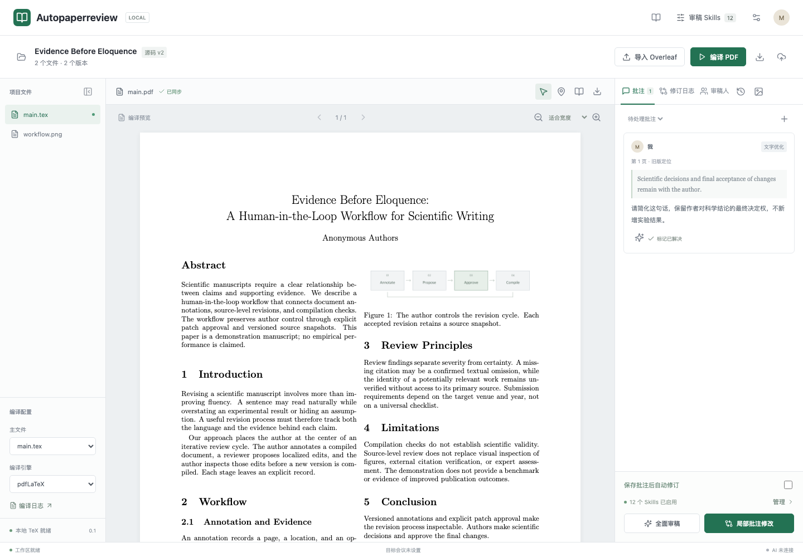
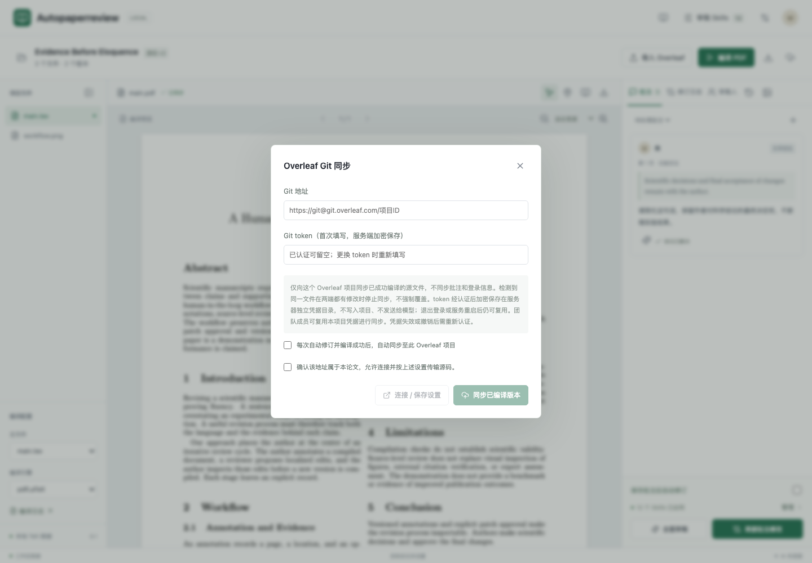

# Autopaperreview

用 PDF 批注驱动 LaTeX 修订，通过本机 Codex 和写作 Skills 检查论文，保存修改理由、模型和版本。此分支只包含审稿网站，不包含 EVA 实验程序或 Docker 文件。

**先讲对，再写顺。** 初稿逻辑不清时，不应反复自动润色。先结合 Related Work 确定 Introduction 主线，再结合真实代码组织 Method，最后逐段修改。

## 安装与本机 Codex

需要 Node.js 22、npm、Git、已安装并登录的 Codex CLI，以及论文所需的 TeX Live / MacTeX / TinyTeX。编译器和 `bibtex` 必须在应用的 PATH 中。

```sh
git clone --branch autoresearch-v0 --single-branch https://github.com/Lil3bear/EVA-Mimir.git
cd EVA-Mimir
npm ci
npm run build
codex login
codex login status
```

使用者登录自己的账户，参见 [Codex 官方认证说明](https://developers.openai.com/codex/auth)。本应用原生适配器检查 ChatGPT 登录状态；仅有 API key 不等于本模式已认证。

```sh
AI_PROVIDER=codex OPENAI_MODEL=gpt-6.1-sol \
LOCAL_REVISION_ONLY=1 ARCHIVE_APPLIED_COMMENTS=1 SETTINGS_LOCKED=1 \
NODE_ENV=production BIND_HOST=127.0.0.1 PORT=4317 \
DATA_DIR="$HOME/.local/share/autopaperreview-data" node server/index.mjs
```

打开 <http://localhost:4317>，先用演示项目检查编译与修改，再导入自己的 Overleaf Source ZIP。型号必须是账户实际支持的模型，不静默替换。本机客户端并不代表离线推理、免费或无限额度。



## 两种工作方式

| 模式 | 实际能力 | 用途 |
| --- | --- | --- |
| 网页提交批注 | 后端调用本机 `codex exec`，显式提供正文与仓库 Skills；返回补丁后校验定位、编译、保存 | 主线明确后的局部修改 |
| 在 Codex 中打开仓库 | 按 [AGENTS.md](AGENTS.md) 读取论文、授权的代码和文献，分阶段审阅与修订 | 初稿诊断、章节重组、Method 与实现对齐 |

网页后台使用受限临时目录，禁用了 Computer Use、浏览器、宿主 Skills 自动发现和任意代码执行。**填写代码仓库地址不会自动读代码，后台也不会自动浏览 Overleaf。** Skills 由 `server/skills.mjs` 注入。完整证据收集和宏观重组应先在交互式 Codex 中完成，不把局部修改接口当成一键全文重构。

交给交互式 Codex 的任务示例：

> 阅读 AGENTS.md 和适用的全部写作 Skills。先合并并备份论文，不调用额外付费模型。结合 Related Work 原文建立差异和证据表，确认 Introduction 的问题、缺口与贡献，再结合指定代码 commit 写 Method。逐阶段给出差异，不只润色，不编造机制或实验。保存并编译，检查 PDF 后再同步 Overleaf。

## Overleaf 与 Computer Use

1. 使用者登录自己的 Overleaf，授权访问目标论文。有 Computer Use 的 Codex 可以辅助打开项目 **Integrations → Git** 获取实际 Git 地址；没有该工具时手工复制。
2. 在网站“Overleaf 同步”填写地址与有效 Git token。浏览器已登录不等于 Git 已认证，Git 能否使用取决于项目权限。
3. 可以授权 Codex 将已有 token 填入本机工作区。不要将 token 发进聊天、源码或 README，不提取浏览器 Cookie。创建或更改凭据、验证码和安全警告按工具规则由用户确认或接管。
4. token 认证后独立加密保存，不进入论文导出和模型上下文。共享工作区成员能复用该项目凭据，因此仅对受信任成员开放。
5. 推送前比较导入基线、本机稿和远端稿。合并两边的修改，也保留远端新增 Bib、主文件设置及图片。当前网站会阻止同文件冲突，需要交互式 Codex 或人工审阅合并；不强推，不改基线跳过冲突。
6. 合并后编译，非强制推送，再 fetch 逐文件核对并记录提交号。网页 PDF 更新、内部 Git 留档、Overleaf 推送是三个独立状态。



## 写作顺序与质量检查

以下是交互式 Codex 的工作规程，**不是已实现的一键编排按钮**。结构未稳定前关闭“保存批注后自动修订”。

| 阶段 | 工作 | 交付与通过条件 |
| --- | --- | --- |
| 基线 | 同步并备份源码、PDF、批注，记录论文版本和代码 commit | 起点明确，可恢复 |
| 全文诊断 | 阅读启用章节、图表、作者意见与实验记录，去重问题 | 区分表达问题、结构问题和缺失证据 |
| Related Work | 阅读相关原文，比较问题、假设、机制与评估范围 | 差异表含来源位置、支持的主张和限制；未核实项明确标注 |
| Introduction | 从真实差异和证据确定问题、缺口、挑战与贡献 | 每项贡献指向实现或结果，不用重命名制造创新 |
| Method | 按已确认引言和指定代码版本检查入口、状态、输入输出、更新、拒绝与终止条件 | 建立“引言主张 → 方法小节 → 代码路径/符号 → 证据”对应表 |
| 局部写作与图示 | 结构稳定后补定义、压缩语言、对齐图中模块和箭头 | 不堆术语或公式，不添加代码没有的机制 |
| 全文反证复核 | 核对摘要、引言、方法、实验、讨论与结论 | 范围、数字、术语一致；有效批评落实，未完成意见保留 |
| 发布 | 编译、检查 PDF、保存日志、审阅后同步并拉回核验 | 源码、PDF 和 Git 提交可追踪，失败不标完成 |

代码默认静态阅读，不执行未知仓库中的攻击、实验或安装脚本。缺代码、原文或实验时列出具体待补材料，不能补造故事。结构变化后重新检查下游章节，旧版通过不等于新版通过。

### 避免越改越差

- 每轮只处理一组明确问题，补丁必须针对当前源码。先宏观后微观，不连续盲改。
- 对比改前与改后：科学含义、证据范围、定义、作者意见和全文一致性；引入新矛盾就拒绝该修改或恢复旧版。
- 不新增未经证实的机制、因果解释、实验数字、首创性和引用。不把文字流畅当成科学正确。
- 简洁直接，克制新术语、装饰性连字符、破折号、引号和不必要的 `\texttt{}`。
- 没有有效改动不归档批注；部分完成保留未完成部分，不以重复告警代替落实。
- 日志记录模型、Skills 文件版本或哈希、输入版本、修改文件、理由、检查结果及提交号。人工复核不能被模型自评代替。

## Skills

共有 **8 个核心模块 + 4 个独立写作/答辩模块 + 4 个图示模块**，完整注册与依赖见 [server/skills.mjs](server/skills.mjs)。按阶段使用全部适用模块，不在每次改句子时强塞画图指令。

| 模块 | 位置与职责 |
| --- | --- |
| 学术表达、十维审稿、论断证据、引用、数学、双盲复现、投稿规则、LaTeX | [skills/modules](skills/modules)，共享问题编号和证据状态 |
| 全文对齐 | [writing-ai-paper](skills/writing-ai-paper/SKILL.md)，证据与全篇主张对齐 |
| 宏观布局 | [zhihu-paper-structure](skills/zhihu-paper-structure/SKILL.md)，贡献归属和叙述主线 |
| 微观可读性 | [zhihu-paper-readability](skills/zhihu-paper-readability/SKILL.md)，逻辑、用词、理解成本 |
| Rebuttal | [paper-rebuttal](skills/paper-rebuttal/SKILL.md)，反证复核与具体回应 |
| 图示故事、布局、科学插画、实验图表 | [图示流程](docs/figure-workflow.md)，方法先行，不编造数据 |

三个知乎模块均标注作者 **丁霄汉**及出处：[宏观布局](https://zhuanlan.zhihu.com/p/593195527)、[微观可读性](https://zhuanlan.zhihu.com/p/639732057)、[Rebuttal](https://zhuanlan.zhihu.com/p/602024489)。只整理规则，不转载全文。其他来源和授权见 [ATTRIBUTION.md](ATTRIBUTION.md)。

## 目录与可选团队模式

`src/` 网页；`server/` 后端与模型适配器；`skills/` 检查规则；`vendor/` 相关审稿资料及许可证；`test/` 回归测试；`public/guide/` 图文指南。`deploy/` 是可选的 Node.js 网关与本机轮询执行器，不是 Docker 或 EVA 程序。

团队流程：浏览器 → 登录网关 → 持久队列 → 本机执行器 → Codex → TeX/PDF/日志。本机须在线，团队共用工作区，不提供每人独立论文隔离。不把本机模型登录目录复制到服务器，不直接公开本机后端。

[安装与提供商配置](docs/INSTALL.md) · [投递和恢复边界](deploy/PULL-EXECUTION.md) · [图文使用指南](public/guide/index.html)

## 验证与边界

```sh
npm test
npm run build
```

测试用隔离数据和模拟模型，不代表上游永远可用；真实修订先用演示稿验证，付费 smoke 脚本执行前确认费用。仅导入可信 LaTeX，编译环境不是恶意多租户上传的安全沙箱。

不发布论文、PDF、批注数据库、token、密码或模型会话。备份 `DATA_DIR`、内部 Git 和独立凭据目录，导出 ZIP 不是完整备份。分支保留正常 Git 历史，旧提交里的 EVA 内容未通过强推清除。
