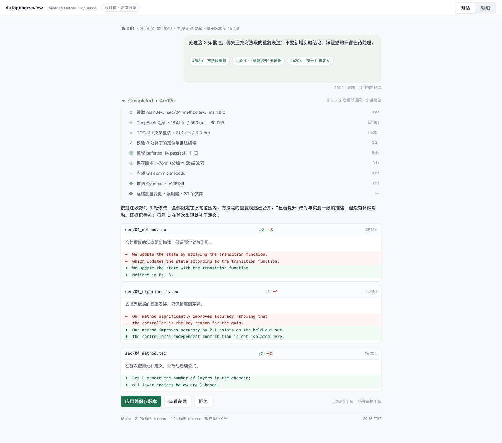
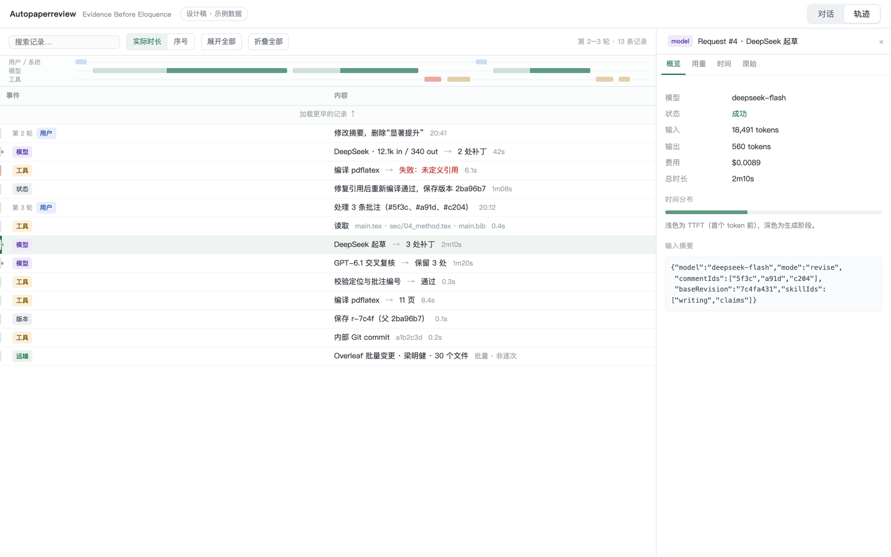
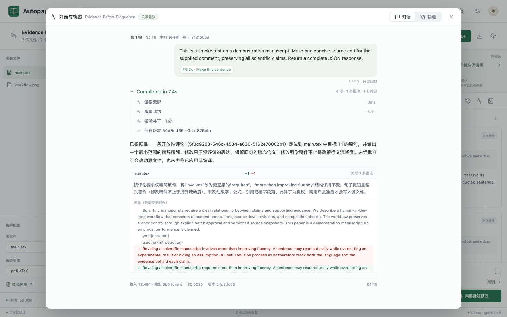
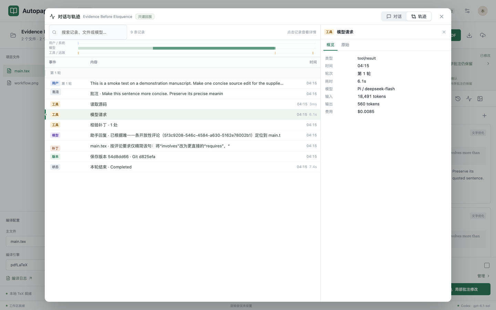

# 对话与轨迹：Chat + Trajectory 设计

面向 [mimir-pi](../README.md) 的网页工作台。可视化稿见 [chat-trajectory.html](mockups/chat-trajectory.html)（示例数据，可直接在浏览器打开）。目标不是再加一个日志页面，而是把「一次修订是怎么发生的」变成可以回放、可以核对、可以交接的内容。

## 0. 先说结论

1. **Chat 和 Trajectory 必须是同一份事件流的两个投影。** Chat 回答「人说了什么、模型回了什么」；Trajectory 回答「中间到底做了哪些步骤、花了多久、改了什么」。分开存两套日志，迟早对不上。
2. **mimir-pi 现在不缺口径，缺时间轴。** 批注、提案、版本、Pi 会话、Git commit、Overleaf 同步都在，但分散在五种结构里，没有统一的 `seq`、时间、发起人和因果关系。
3. **Overleaf Git 历史只能补「远端改了什么」，补不了 trajectory。** 实测本项目：3 个 commit，其中 2 个是 `Update on Overleaf.`，按 Overleaf 账号归因，一次提交批量包含几十个文件的改动；没有逐次编辑、没有意图、没有模型调用。它是补丁账本，不是轨迹。
4. 推荐路线：**先只读回放（P0）**，用现有数据反推事件流；**再结构化采集（P1）**，把 `codex`/`pi` 的中间事件和内部步骤写进 JSONL；**最后才做远端轮询（P2）**。P0 不改模型调用，风险最低，能先验证 UI 值不值得。

---

## 1. 现状盘点

| 数据源 | 位置 | 现有粒度 | 是否持久 | 能回答什么 | 缺什么 |
| --- | --- | --- | --- | --- | --- |
| 批注 | `project.json` 的 `comments[]` | 单条意见 | 是 | 谁在什么位置提了什么 | 与模型步骤的时序关系 |
| 提案 | `proposals[]` | 一次修订的结果 | 是 | 改了哪些行、为什么、关联哪些批注 | 中间尝试、被丢弃的草稿 |
| 版本 | `history[]` + `revisions/` + `source-history.git` | 每次应用一个 commit | 是 | 版本差异、provenance、发起人 | 编译耗时、失败重试 |
| 后台任务 | `jobs/<jobId>.json` 的 `events[]` | 5–10 条中文进度句 | 是 | 「读批注→调模型→校验→编译→保存」 | 模型阶段、token、工具级细节 |
| Pi 会话 | `pi-sessions/<dir>/*.jsonl` | 原始 prompt/response | 是 | 完整输入输出、`usage.cost` | 索引、脱敏、可读摘要（prompt 常 80KB+） |
| 内部 Git | `source-history.git` | 每版本一个 commit | 是 | 精确的行级差异 | 作者只有 `Autopaperreview`，非个人 |
| Overleaf 远端 | 本地 bare clone + `overleaf.syncHistory` | 仅同步时 fetch | 是 | 远端 head、推送记录 | 日常网页编辑不轮询，看不到 |
| 工作区记录 | `experience/events.json` | 去重后的事实快照 | 是 | 事后审计、导出 MD | 无顺序语义、无 UI |
| 成员 | `members.json`、presence | 身份 + 在线 | 是 | 谁发起 | 与事件未绑定 |

**判断**：这些数据已经足够拼出 P0 的「事后轨迹」，但拼不出「实时轨迹」，也拼不出模型内部的推理/工具链。要做 DSH 那样的体验，需要在事件产生的那一刻就按统一 schema 落盘。

---

## 2. DSH 的 Chat + Trajectory 是什么

参考本机 DSH 客户端的四个插件包（`@deepseek-ai/dsh-client-ui-chat`、`ui-trajectory`、`ui-conversation`、`ui-tool`）的 README 与实现，可以把它拆成下面几层。

### 2.1 一份事件流，两个视图

- `ui-conversation` 维护 **Session 事件窗口**（durable events + 瞬态事件，每条有 `type`/`seq`/`time`/`data`）。
- Chat 和 Trajectory 都只是 **Definition + View**：各自订阅同一份事件，组装自己的节点；Trajectory 明确写着 “a pure projection”，不读也不改 Chat 的快照。
- 好处：切 tab 不需要二次请求；Chat 折叠掉的过程，Trajectory 仍能展开；两边的 id 天然对齐。

### 2.2 事件形状与三层结构

```jsonc
// 一行一个 durable event
{"type":"tool/call","seq":118,"time":1762123928412,
 "data":{"turn":3,"step":2,"callId":"c_9","name":"read","arguments":"{\"path\":\"main.tex\"}"}}
```

- `seq` 是唯一的排序/锚点键（分页、跳转、折叠区间都按它算）；`time` 是唯一的时钟。
- 一层 `type` 区分 durable 与瞬态；瞬态流式帧在结算后合并进 `assistant/message`，不重复。

| 层 | 含义 | DSH 事件 |
| --- | --- | --- |
| Turn | 一次用户请求到一次完整交付 | `turn/start`、`turn/end` |
| Step | Turn 内的一次模型尝试（可重试） | `step/start`、`step/end`、`assistant/message` |
| Request | 一次具体的模型请求（带 model/prompt/usage/retry） | `request/header`、`turn/end` |
| Row | 账本里的一条可检视记录 | `user/message`、`tool/call`、`tool/result`、`compaction` |

真实日志里出现过的类型（节选）：`turn/start`、`step/start`、`step/end`、`user/message`、`assistant/message`、`tool/call`、`tool/result`、`command/run`、`command/done`、`job/registered`、`job/settled`、`subagent/catalog`、`llm/retry`、`session/title`。这套命名值得直接沿用——`tool/call` + `tool/result` 用 `callId` 配对，结果里回指 call 的 `seq`。

### 2.3 Chat 的具体规则

- **单列居中，宽 748px**（`--dsh-chat-content-width`），行间距 6px，助手回复后 12px，Turn 过程头前后 16px。
- **用户行**：右对齐气泡，`10px 16px` 内边距，正文 `pre-wrap`，最宽 `min(70.2%, 82%)`；气泡下方是时间 + 复制 + 分支；本地回显与权威记录原子替换。
- **助手行**：没有气泡，按原始 block 顺序渲染（text → Markdown，reasoning → 折叠行，image → 图库，tool-call 交给工具卡片）。
- **过程头（最值得抄）**：每个已完成的 Turn 顶部一行 14px 文字按钮（左侧图标，悬停时图标换成 chevron），文案是「Completed in 12s ▾」，附带 `N 条消息 / N 次工具调用`；错误/中断的 Turn 不显示耗时，只显示 Failed / Stopped；展开后过程体最高 `min(400px, 50vh)`，上下各 24px 渐隐。
- **工作细节四档**：

| 档位 | 折叠已完成 Turn | 过程行分组 | 实时过程 | 推理预览 |
| --- | --- | --- | --- | --- |
| Compact | ✓ | 折叠 | ✗ | ✗ |
| Standard | ✓ | 折叠 | ✓ | ✓ |
| Detailed（默认） | ✓ | 历史 | ✓ | ✓ |
| Verbose | ✗ | 不分组 | ✗ | ✓ |

- **推理行**：不是 spinner，是一条可展开行；折叠摘要 = 已定稿时的首行；流式中 = **最后一个已完成段落的首行**，随段落推进而变化。
- **工具行**：`图标 · 标题 · 分隔点 · 摘要 · 后缀 · +N −N`，13px/24px，单行省略；状态由 call/result 冻结，过去失败的行永远显示失败；退出码用中性胶囊 + 红点，不给整行染色。
- **失败与重试**：中间重试单独一行（「Retrying model request (2/5) · 12s」+ 倒计时）；终态失败一行红点 + 错误码；进程中断显示「Stopped」，不编造原因。
- **Turn 尾部**：只在该 Turn 的 `turn/start` 与全部模型尝试的 usage 都齐全时，才显示可展开的 token 明细；缺一项就整体不显示。
- **Turn 导航条**：右侧 28px 竖条，每个 Turn 一个 10px 刻度，未加载的 Turn 变暗，悬停显示「一行提问 + 三行回答」预览；点击未加载的 Turn 会先翻页再落位。

### 2.4 Trajectory 的具体规则

- **账本是一张表**：行高 30px；第一列固定 122px（中文 84px，窄容器 50px），放 Turn 竖线、选中竖线、`Turn N` 标签和类型 chip（user 蓝 / context 绿 / tool 琥珀 / subtool 浅琥珀 / message 紫 / system 中性）；第二列自适应，工具行是「请求 → 结果」两列，箭头分隔。
- **Request 边界点**：每次模型请求开始的那一行左侧一个 5px 圆点，悬停显示 `Request #N`，出错变红——这是最便宜的「模型调用从哪开始」提示。
- **Inspector**：右侧 `clamp(320px, 38%, 440px)`，可拖拽（8px 手柄，键盘左右键，双击复位）；顶部 42px 标题 + 34px tab 条；按类型给不同 tab：Overview / Input / Output / Timing / Usage / Diff / Raw。
- **时间条**：账本上方固定 50px，三条泳道（user/system/context、message、tool/subtool），14px 间距；助手跨度按 TTFT 拆成浅色/实色两段；拖拽=聚焦区间（区间外的行降到 24% 透明度），滚轮=缩放，右键=清除。
- **长历史**：虚拟列表，首屏 50 条，从尾部开始；「Load earlier」行每次向前加载一页；prepend 时行 key 和 `aria-rowindex` 保持稳定。
- **折叠**：一个 Turn 有多条内容行时可以折成 20px 摘要行；工具行可折叠其参数/结果。
- **不虚构**：进行中的记录只画起点，不显示「已运行 3 分钟」；历史记录的时间来自真实时间戳。
- **没有深链**：Trajectory 自己不做锚点跳转，跳转方向是 **Chat → Trajectory**（工具卡片上的 Inspect 胶囊传入 `callId`，Trajectory 选中对应记录）。

### 2.5 可直接照抄的尺寸与文案

| 项 | 值 |
| --- | --- |
| Chat 列宽 | 748px，单列居中 |
| 行距 | 6px；助手回复后 12px；过程头前后 16px |
| 用户气泡 | `10px 16px`，圆角 xl，`pre-wrap` |
| 工具行 | 13px / 24px，单行省略 |
| Trajectory 行高 | 30px；表头 30px |
| 事件列宽 | 122px（zh 84px / 窄屏 50px） |
| 类型 chip | 19px 高，10px 字号，650 字重 |
| Inspector | 320–440px，拖拽手柄 8px |
| 时间条 | 50px 高，3 条泳道，14px 间距 |
| 折叠摘要行 | 20px |
| 过程头 | 14px 文字按钮；过程体 `max-height: min(400px, 50vh)`，上下渐隐 24px |
| 过程头文案 | `Completed in 12s ▾` / `Failed` / `Stopped` |
| 重试行 | `Retrying model request (2/5) · 12s` |
| 虚拟化批大小 | 50 条 |

### 2.6 值得借 / 不照搬

| 值得借 | 不照搬 |
| --- | --- |
| 一份事件流、两个投影 | 多 View 的 slot 注册框架（mimir 只有一个侧栏） |
| Turn → Step → Row 分组 | 通用工具卡片体系（LaTeX 工具只有 8 类） |
| 过程折叠 + 四档细节 | 分支/fork、compaction、多 Session 绑定 |
| 推理行摘要随段落推进 | 图片灯箱、附件卡片 |
| 冻结的 call/result 状态 | 748px 的杂志式排版（右侧栏只有 ~380px） |
| 时间条拖拽过滤 | 三泳道时间条（mimir 一轮只有几十分钟，先做两泳道即可） |
| Inspector 分 tab | 虚拟化（P0 数据量小，分页即可） |
| Chat 的 Inspect → Trajectory 跳转 | 深链/分享链接 |

### 2.6 不打算照搬

多目标 slot 注册、虚拟化、compaction、多 Session 绑定、图片灯箱这些是通用 Agent 客户端的复杂度；mimir-pi 是单项目、单写者、以论文为中心的工具，先把「一次修订的可读账本」做好。

---

## 3. 映射到 mimir-pi

| DSH 概念 | mimir-pi 概念 | 说明 |
| --- | --- | --- |
| Session | 项目内的写作会话（可按天/按版本切） | 一个项目一条主会话，避免碎片化 |
| Turn | 一次「提交本轮」 | 从点击开始到保存版本/拒绝/失败 |
| Step | 一个修订阶段 | draft / refine / crosscheck；每阶段一次模型请求 |
| Request | 阶段内的一次模型调用（可重试） | 带 `provider/model/usage/error/retry`，Inspector 读这一层 |
| Tool call | 读源码、调模型、校验补丁、编译、写版本、commit、fetch/push | 每个都有明确的输入输出 |
| User message | 本轮要求 + 选中的批注 | 批注以 chip 形式附在消息里，正文不重复 |
| Assistant message | `summary` + findings + patches | 已有结构，直接映射 |
| Inspector | 补丁详情/编译日志/token/耗时 | 复用现有 modal 内容 |
| Timing | 每步耗时、模型 token/cost | Pi 会话里已有 `usage.cost` |

**产品口径**：这不是「和 AI 聊天改论文」的通用聊天框，而是**把每次修订讲清楚**。真正的连续对话（多轮追问、上下文继承）是二期，先把「一次修订的对话化呈现」做对。

---

## 4. 事件模型

### 4.1 存储布局

```text
DATA_DIR/<projectId>/
  traces/
    index.json                 # 会话/轮次索引，供列表页快速加载
    <traceId>.jsonl            # append-only，一行一个事件
  pi-sessions/                 # 已有：原始模型报文（不复制进 trace）
  jobs/<jobId>.json            # 已有：兼容保留
```

- 权限 `0600`，目录 `0700`；不进导出 ZIP，不进论文 Git。
- 一行一个事件，追加写，崩溃最多丢最后一行；读取时跳过残缺尾行。
- `index.json` 可重建：扫 JSONL 的 `turn/start`/`turn/end` 生成。

### 4.2 事件结构

```json
{
  "seq": 42,
  "id": "evt_01JC...",
  "traceId": "tr_01JC...",
  "projectId": "c68b9ce9-...",
  "turn": 3,
  "step": 2,
  "time": "2026-11-02T20:12:08.412Z",
  "type": "tool/result",
  "visibility": ["trajectory"],
  "actor": {"kind": "system", "memberId": null, "name": "Autopaperreview"},
  "model": {"provider": "deepseek", "id": "deepseek-flash"},
  "data": {
    "tool": "compile",
    "status": "ok",
    "durationMs": 8421,
    "detail": {"engine": "pdflatex", "pages": 11, "logRef": "revisions/<rev>/build.log"}
  },
  "refs": {"revision": "d253400a-...", "proposal": "5f3c...", "commentIds": []}
}
```

字段约定：

| 字段 | 必填 | 说明 |
| --- | --- | --- |
| `seq` | 是 | 单条 trace 内单调递增，从 1 开始 |
| `id` | 是 | 幂等键；重复写入直接忽略 |
| `turn` / `step` | 是 | 用于分组；`step=0` 表示 turn 级事件 |
| `type` | 是 | 见 4.3 |
| `visibility` | 是 | `chat` / `trajectory` / 两者都有；决定默认显隐 |
| `actor` | 是 | 人或系统；模型单独放 `model`，不混为一谈 |
| `data.status` | 视类型 | `running` / `ok` / `failed` / `cancelled` |
| `refs` | 否 | 指向版本、提案、批注、commit、Pi 会话目录 |

### 4.3 事件类型

| type | 可见性 | 何时写 | 关键字段 |
| --- | --- | --- | --- |
| `session/start` | both | 打开项目/新建 trace | `model`, `baseRevision` |
| `turn/start` | both | 提交本轮 | `instruction`, `commentIds`, `baseRevision` |
| `comment/attach` | chat | 本轮选中的批注 | `commentId`, `quote`, `file`, `page` |
| `step/start` | trajectory | 进入一个阶段或模型调用 | `step`, `kind`, `model` |
| `step/end` | trajectory | 阶段结束 | `status`, `durationMs`, `usage` |
| `assistant/message` | both | 模型返回结构化结果 | `summary`, `coverage`, `findings`, `usage` |
| `assistant/thinking` | trajectory | 仅当 provider 真的给了 reasoning | `text`, `summary`, `source:"provider"` |
| `tool/call` | trajectory | 任一步开始 | `tool`, `args`（脱敏） |
| `tool/result` | trajectory | 该步结束 | `tool`, `status`, `durationMs`, `detail` |
| `patch/proposed` | both | 校验通过的补丁 | `file`, `before`, `after`, `reason`, `commentIds` |
| `patch/rejected` | both | 人工拒绝 | `proposalId`, `reason` |
| `revision/created` | both | 编译通过并保存 | `revisionId`, `parent`, `pdf` |
| `git/commit` | trajectory | 内部 Git 留痕 | `commit`, `files` |
| `overleaf/push` | both | 推送成功/失败 | `remoteCommit`, `files`, `status` |
| `overleaf/flush` | both | 轮询发现远端新提交 | `commit`, `author`, `stat`, `attribution` |
| `compile/failed` | both | 编译失败 | `logRef`, `line` |
| `turn/end` | both | 本轮终态 | `outcome`, `durationMs`, `usage` |
| `error` | both | 未归类失败 | `code`, `message` |

`data.tool` 的取值固定枚举：`source.read`、`model.request`、`patch.validate`、`compile`、`revision.write`、`git.commit`、`overleaf.fetch`、`overleaf.push`、`experience.record`。新增工具必须登记，避免自由字符串；事件类型本身保持稳定，便于前端按 `type` 分派。

### 4.4 不写进 trace 的东西

- **完整 prompt**。Pi 会话里已有 80KB 原文；trace 只写 `piSessionRef`、prompt 哈希、token 数。否则 JSONL 会膨胀到不可读，也扩大泄漏面。
- **Token、密钥、Cookie**。沿用 `experience.mjs` 的 `clean()` 规则，写前再过一遍。
- **模型原始思考**。只有 provider 明确返回时才记录，标记 `source: "provider"`；不推断、不补写。
- **被拒绝提案的全文**？保留补丁正文可以（用户需要看改了什么），但 `reason` 要截断到合理长度。

---

## 5. 采集改造

### 5.1 `server/codex.mjs`：现在只解析了 4 种事件

现状（约 130–160 行）只处理 `turn.started`、`item.completed`(agent_message)、`error`、`turn.failed`，其余 JSONL 全部丢弃。Codex `exec --json` 还会给出：

- `item.completed` + `item.type === "reasoning"`（摘要）
- `command_execution`（命令、退出码、输出）
- `file_change`（路径与变更类型）
- `turn.completed`（`usage`）

改造：把 `item.started` / `item.completed` 映射成 `tool/call` + `tool/result`，`agent_message` 映射 `assistant/message`，`reasoning` 映射 `assistant/thinking`（标记 provider 来源），`turn.completed` 写 usage。**注意**：当前 Codex 以 `--sandbox read-only` 运行，`file_change` 不会出现，不要为了有轨迹而放开沙箱。

### 5.2 `server/pi-cli.mjs`：已经有最完整的材料

`pi --mode json` 的输出和 `pi-sessions/*.jsonl` 已经包含：

- user message（系统提示 + 正文 + 批注）
- assistant message（`content`、`usage.input/output/totalTokens`、`cost`）
- 失败时的 `stopReason=error` + `errorMessage`

改造：`executePi` 结束后读本次 session 文件，提取 `usage`、耗时、模型 id，写 `model.request` 的 `tool/result`；`onProgress` 里已有的 `piSessionDirectory` 作为 `refs.piSession`。**不要把 user message 全文塞进 trace**。

### 5.3 `server/jobs.mjs`：把 `progress()` 变成唯一出口

现在 `progress({phase, message})` 只写进 job state。建议：

```js
progress(event)  // 兼容旧调用
  -> trace.emit({type: mapPhase(event.phase), ...event})
```

保留 `jobs` 的持久化与前端轮询，不动状态机；trace 是旁路，写失败只告警，不影响修订。

### 5.4 `server/index.mjs`：补上「工具级」节点

`applyProposal` 里已有校验、编译、`snapshot`、`git`、`pushOverleaf` 的调用点。每个点前后各发一条 `tool/call` / `tool/result`，耗时用 `performance.now()`。特别注意：

- `planSync` 的冲突要写成 `overleaf/push` 的 `failed`，不要吞成通用 error。
- `snapshot` 成功后才写 `revision/created`，不要提前。

### 5.5 Overleaf 轮询（P2，可选）

新增 `server/overleaf-watch.mjs`：

1. 每 N 分钟对本地 bare clone 执行 `fetch origin <branch>`（复用 `overleaf.mjs` 的 `git()`，token 走环境变量，不上命令行）。注意：commit 是 fetch 时**按需补造**的，轮询提高的是「多快能看到」，不是「记录多细」。
2. 比较 `FETCH_HEAD` 与上次记录：逐条遍历新增 commit，`git diff-tree --stat` + `git log -1 --format`，每个 commit 写一条 `overleaf/flush`。
3. 默认 N=10 分钟；只在项目页面打开时轮询，避免空转和限流；失败退避到 30 分钟。

**归因**：`author` 来自 commit（该版本最后编辑者），标记 `attribution: "version-author"`；同窗口多人编辑时标记 `"window"` 并在 UI 说明「只保留最后编辑者」；拿不到作者时 `"unknown"`，显示「远端版本变更」，不要猜人。

### 5.6 归因规则

| 场景 | `actor` | 展示 |
| --- | --- | --- |
| 成员点击提交 | `{kind:"member", memberId, name}` | 姓名 + 时间 |
| 自动修订 | `{kind:"system", name:"自动修订"}` + `triggeredBy` | 「由 X 的批注触发」 |
| 模型 | 不进 `actor`，进 `model` | 「DeepSeek V4.1 Flash」 |
| Overleaf 网页编辑 | `{kind:"remote", name: commit.author}` | 「Overleaf 网页编辑 · 梁…」+「批量」 |
| 历史共享账号 | `{kind:"legacy"}` | 「历史共享账号」 |

---

## 6. API 与前端

### 6.1 接口

```text
GET /api/projects/:id/traces                    # 会话/轮次列表（分页）
GET /api/projects/:id/traces/:traceId?after=42  # 增量拉取事件
GET /api/projects/:id/traces/:traceId/export    # 脱敏后的 JSONL/MD
```

- 轮询复用现有 2 秒节奏：`after=seq`，只回新增；返回 `{events, lastSeq, running}`。
- 单次上限 200 条；超出走分页。P0 不需要 SSE，SSE 留到 P2。

### 6.2 布局

现有三栏是 `210px + PDF + 338px`（宽屏 370px）。338px 放不下 748px 的对话列，所以 **Chat/Trajectory 激活时侧栏要变宽**，而不是硬塞进 338px：

| 方案 | 做法 | 优点 | 缺点 |
| --- | --- | --- | --- |
| A（推荐）可拖拽分栏 | 打开对话/轨迹时侧栏自动扩到 ≥720px（上限 70% 视口），PDF 缩窄；可拖回 | 能边看 PDF 边看过程 | 需要改 grid + 拖拽手柄 |
| B 全屏覆盖 | 点「查看过程」全屏，Chat/Trajectory 占满，PDF 暂时隐藏 | 最像 DSH，实现最省 | 看不到 PDF |
| C 侧栏加宽固定 | 直接把 338px 改成 520px | 改动小 | 日常批注时 PDF 被压缩 |

建议 A + B 兜底：宽屏分栏，窄屏（<1100px）自动退化成全屏。

```text
PDF（可缩窄）                    │  侧栏：批注 | 修订 | 对话 | 轨迹   ⤢
                                │
                                │  第 3 轮 · 2026-11-02 20:12
                                │  你：处理这 3 条批注，优先压缩方法段…
                                │   · 批注 3 条 · DeepSeek 起草 → GPT 复核
                                │
                                │  Completed in 4m12s ▾
                                │   ├ 读取 main.tex + sec/04_method.tex
                                │   ├ DeepSeek 起草 · 18.4k in · $0.009
                                │   ├ GPT-6.1 复核 · 21.2k in · 1m20s
                                │   └ 编译 pdflatex · 8.4s · 11 页
                                │
                                │  助手：修改了 3 处，保留 1 条待补实验…
                                │  [+5 −6] [查看差异] [应用] [拒绝]
```

- **对话**：只显示「人 / 助手 / 过程头」；过程默认折叠成一行，点开在原地展开（不跳转）。
- **轨迹**：完整账本，30px 行，顶部 50px 时间条，右侧 Inspector；类型 chip 区分读、模型、补丁、编译、Git、云。
- 两个 tab 共享滚动位置与选中记录；从补丁点「定位」跳 PDF 页，从版本点「差异」复用现有 modal。
- 侧栏宽度、折叠档位、时间条开关存 `localStorage`，按项目隔离。

两张预览（示例数据，来自 [设计稿](mockups/chat-trajectory.html)）：

| 对话 | 轨迹 |
| --- | --- |
|  |  |

### 6.3 交互细节

- **跟随尾部**：运行中自动滚到底；用户上滚后停止跟随，出现「回到最新」按钮。
- **折叠**：`tool/*` 默认折叠成单行（图标 + 标题 + 状态 + 耗时）；失败默认展开；只在本轮运行中显示 shimmer。
- **空态**：没有历史时显示「提交第一条批注后，这里会出现本次修订的完整过程」，不显示假数据。
- **长文本**：补丁 `before/after` 超过 40 行时只显示前 20 行 + 「展开全部」。
- **窄屏**：`<1100px` 时对话/轨迹全屏；时间条隐藏，保留耗时文字。
- **键盘**：`j/k` 上下选择记录，`Enter` 打开 Inspector，`Esc` 关闭；`g`/`G` 跳到首尾。
- **跳转**：工具行右侧的「检视」胶囊切到轨迹并选中该记录（对应 DSH 的 `toolCallFocus`）。

### 6.4 性能

- 单 trace 超过 500 条时分页，首屏只取最后 50 条。
- 补丁正文按需拉取（列表只带 `patchId` + 摘要），避免一次传几 MB。
- 渲染用 key=`seq`，避免流式追加时整列重排。

---

## 7. Overleaf Git 历史：能做到什么，做不到什么

### 7.1 实测（本机真实项目 `git.overleaf.com/6ae0ad56…`）

用该项目的既有凭据做只读 `clone`，没有推送、没有改远端：

```text
$ git log --format="%h | %an <%ae> | A:%ad | C:%cd | %s"
e428189 | mingjian liang <2443…@qq.com> | A:2026-11-02T05:53:28Z | C:2026-11-02T13:01:10Z | Update on Overleaf.
9b2c441 | Autopaperreview <autopaperreview@localhost> | 2026-10-27T13:57:19Z | Autopaperreview: synchronize compiled local revision
93e1070 | mingjian liang <2443…@qq.com> | A:2026-10-27T13:55:34Z | C:2026-10-27T13:57:12Z | Update on Overleaf.
```

### 7.2 机制：提交是「按需补造」的，不是编辑时写的

Overleaf 官方文档写得很直接：Git 集成是「Overleaf 历史/版本机制到 Git 的翻译」；执行 `pull`/`fetch` 时，如果当前项目状态还没有对应 commit，才**动态创建**一个；网页编辑期间不会自动产生 commit。[Git integration 文档](https://docs.overleaf.com/integrations-and-add-ons/git-integration-and-github-synchronization/git-integration)

git-bridge 源码（[GitProjectRepo.java](https://github.com/overleaf/overleaf/blob/main/services/git-bridge/src/main/java/uk/ac/ic/wlgitbridge/bridge/repo/GitProjectRepo.java)）解释了本机看到的三个现象：

| 现象 | 原因 |
| --- | --- |
| `committer node <node@git-bridge-prod-0>` | 只 `setAuthor`，不 `setCommitter`，committer 落到容器默认身份 |
| author 时间比 committer 早 7 小时 | author date = Overleaf 保存版本的时间；committer date = 这次 fetch/clone 补造 commit 的时间 |
| 一次提交含 30 个文件 | 一个版本内的所有改动合成一个 commit；同一窗口多人编辑，只记**最后一个编辑者**为 author |

版本粒度来自 document-updater 的 flush（约 100 个未刷新操作或 300 秒），所以「一次提交」通常对应**几分钟的编辑窗口**，而不是一次击键。官方文档也明确：如果一个 commit 前有多处修改，作者是「最近一次修改的人」。分支、tag、强制推送都不支持，只允许 `main` 单分支，`--force` 会被拒绝。

### 7.3 能拿到 / 拿不到

| 想知道的 | Git 历史 | 说明 |
| --- | --- | --- |
| 谁改的 | ⚠️ 版本级 | 该版本最后编辑者；同窗口其他作者丢失 |
| 什么时候改的 | ✅ 版本时间 | author date；commit 时间只代表 fetch |
| 改了哪些文件/行 | ✅ | `git diff` 精确 |
| 编辑顺序 | ⚠️ 版本间有，版本内无 | 版本内所有改动已合并 |
| 为什么改 | ❌ | 没有 rationale、没有批注关联 |
| 被拒绝/未采纳的草稿 | ❌ | 从未落盘 |
| 模型调用、token、编译 | ❌ | 不在 Overleaf |
| 版本标签/说明 | ✅ | 版本说明会成为 commit message；默认 `Update on Overleaf.` |
| 旧版本内容 | ✅ | `git checkout <sha>`；History UI 也能下载单个版本 zip |
| 逐行/逐人归因 | ❌ | 只有 History UI 的高亮；无公开导出 |

### 7.4 可选策略

| 策略 | 做法 | 粒度 | 成本 | 适用 |
| --- | --- | --- | --- | --- |
| A. 轮询补账（推荐做 P2） | 每 5–15 分钟 `fetch`，把 `git log --format` + `diff-tree` 追加到本地 JSONL | 版本级（约 5 分钟窗口） | 低；注意限流与退避 | 有人坚持在网页里改 |
| B. 规范标签 + 全员 Git | 每次重要修改后在 Overleaf 里打版本标签；改稿人用自己的 `user.name/email` 提交 | 版本 / commit（真实作者） | 中，需协作约定 | 团队愿意改习惯 |
| C. 内部 History 接口 | 带登录态调 `/project/:id/changes`（含 `authors[]` 与逐操作记录） | 版本 / 操作级 | 高；未公开、会话+CSRF、ToS 风险 | 仅研究/审计，不做产品依赖 |
| D. History UI 人工核对 | 在网页 History 里逐版本看高亮与作者 | 逐次（人工） | 高，不可自动化 | 争议复盘、事故调查 |

**建议**：默认 A，把远端变更如实标注成「版本级、作者为窗口内最后编辑者」，不要伪装成逐次编辑；重要项目推行 B；C 只作为线下的研究手段，不做产品依赖；D 留给争议复盘。

策略 B 的落地细节：服务端只允许 `main` 一个分支，所以每人本地开分支、push 时用 `git push overleaf alice:main` 顺序推；推之前先 `fetch`，non-fast-forward 会被拒绝（也不允许 `--force`）。每完成一段重要修改就在 Overleaf 里打一个版本标签，标签会成为 commit message，也强制生成版本边界。

### 7.5 合规与隐私

- Overleaf Git token 只用于 `fetch`，不进 trace、不进日志、不上命令行（沿用 `overleaf.mjs` 的 `GIT_CONFIG_*` 环境变量方式）。token 是**账号级**的，最多 10 个、一年过期，没有项目级 token。
- commit 里的个人邮箱会暴露给所有有 Git 权限的人；如果团队介意，建议统一用项目邮箱，或在 UI 里只显示姓名。
- 免费版 Git 集成是付费功能（Cloud），没有只读档；轮询过频会被限流，需要退避。
- 不抓浏览器 Cookie、不调未公开的 History 接口、不做页面自动化；这些既不稳定，也超出项目授权范围。
- 远端内容只在本地比较，不整篇发给模型。

### 7.6 结论

> **可以「看到」其他人的编辑，但看到的是版本级的补丁账本，不是 trajectory。** 它能回答「哪个版本里哪些文件被改成了什么、最后是谁改的」，回答不了「逐次编辑的顺序、他为什么这么改、试过什么、哪一步失败了」。真正的 trajectory 只能在**事件发生的地方**采集——也就是 mimir-pi 自己的对话与执行链路里。

---

## 8. 分阶段实施

| 阶段 | 范围 | 改动文件 | 风险 | 验收 |
| --- | --- | --- | --- | --- |
| **P0 只读回放（已实现）** | 从 `jobs/*.json`、`proposals`、`history`、`syncHistory`、`experience`、本地 Overleaf bare clone 的 `git log` 反推事件，渲染对话与轨迹；不新增写入 | 新增 `server/traces.mjs`；`index.mjs` 三个 GET；`main.jsx` 两个 tab | 低：只读，不影响修订 | 能在现有历史项目里回放出「提交→模型→补丁→编译→版本」，并列出已抓到的远端提交 |
| **P1 结构化采集** | `trace.emit` 接入 `progress`；Codex/Pi 的 usage 与阶段；补丁/编译/commit 工具节点 | `codex.mjs`、`pi-cli.mjs`、`jobs.mjs`、`index.mjs`、`ai.mjs` | 中：写失败必须不影响主流程 | 新跑一轮，轨迹里有 ≥6 类事件、token、耗时、补丁 |
| **P2 远端轮询** | Overleaf watcher + `overleaf/flush` + 版本级归因 | 新增 `overleaf-watch.mjs`；`overleaf.mjs` 复用 | 中：网络/限流；只读 | 网页编辑后 15 分钟内出现「版本变更」，作者标为窗口内最后编辑者 |
| **P3 对话化** | 多轮追问、引用上一轮结果、按会话导出 | `ai.mjs` prompt、`main.jsx` composer | 高：改模型契约 | 用户可在同一会话里连续提要求，且每轮可回溯 |

**先做 P0 的理由**：不改写入路径，不动模型调用，能把「值不值得」先验证掉；P0 的事件反推逻辑（`turn/step` 推导、补丁归属、时间排序）在 P1 里可以原样复用。

---

## 9. 测试与验收

| 层 | 用例 |
| --- | --- |
| 事件 | `seq` 单调；重复 `id` 幂等；残缺尾行可跳过；`clean()` 脱敏 `sk-`/`olp_`/URL 密码 |
| 投影 | 同一份 JSONL 生成 Chat 与 Trajectory，turn/step 数一致；失败轮次不生成「已保存」 |
| 边界 | 空项目；只有批注没有提案；提案被拒；编译失败；Overleaf 冲突 |
| 兼容 | 旧 `jobs/*.json` 能回放；`experience.md` 导出不重复 |
| 性能 | 500 条事件首屏 < 300ms；增量轮询只传新事件 |
| 安全 | trace 不含 token/完整 prompt；导出文件与网页显示一致 |

手动验收脚本（P0）：

1. 打开 `Evidence Before Eloquence` 项目，切到「对话」，应看到 1 轮、3 条批注、1 个提案、2 个版本。
2. 切到「轨迹」，应看到 `model.request`、`patch.validate`、`compile`、`git.commit` 四类节点，时间顺序正确。
3. 打开任一批注的「来源轮次」，能跳回对话并高亮对应行。
4. 打开 Overleaf 项目，轨迹里应出现 3 条远端提交（含 2 条 `Update on Overleaf.`），标注「批量」。

---

## 10. 开放问题

1. **Trace 的边界**：一个项目一条 trace，还是每次提交一条？建议「项目一条 + turn 分段」，导出时按 turn 切。
2. **对话是否要真的可输入**：P0 的「对话」是只读呈现；如果要做 composer，需要先定义「追问」如何转成下一轮的 prompt，否则会出现「看起来能聊、实际不生效」。
3. **模型思考**：DeepSeek 当前 `thinking=off`，没有 reasoning 可展示；不要为了对齐 DSH 去打开思考（成本、延迟、口径都会变）。
4. **多人实时**：现有 presence 是 20 秒心跳；如果要做「谁正在看哪一轮」，需要更细的 presence，不建议 P0 做。
5. **数据保留**：trace 会包含批注原文与补丁；`DATA_DIR` 备份策略要同步更新，README 的「私有数据」段落需要补一句。

---

## 11. P0 实现记录（已完成）

这一轮只做只读回放：不新增写入路径，不改模型调用，不动 Overleaf。入口在右侧栏的「对话与轨迹」图标。

### 11.1 新增与修改

| 文件 | 内容 |
| --- | --- |
| [server/traces.mjs](../server/traces.mjs) | 从 `project.json` / `jobs/*.json` / Pi 会话 / `source-history.git` / Overleaf bare clone 推导 turn、事件与远端 commit |
| [server/index.mjs](../server/index.mjs) | `GET /api/projects/:id/traces`、`GET /api/projects/:id/traces/:traceId`（支持 `?after=seq`） |
| [src/trace-view.jsx](../src/trace-view.jsx) | 覆盖层：对话 / 轨迹、折叠、时间条、Inspector、远端卡片 |
| [src/main.jsx](../src/main.jsx) | 右侧栏入口按钮；项目打开时按需加载 |
| [src/style.css](../src/style.css) | `.trace-*` 样式，沿用现有绿色与灰色 token |
| [test/traces.test.mjs](../test/traces.test.mjs) | 推导、截取、远端日志、Pi 用量与路径边界共 7 个用例 |

### 11.2 数据口径

- **turn**：优先取 job（含 request/status/时长），没有 job 的提案与手动版本各自成轮；「导入项目」不算一轮。
- **事件**：`turn/start`、`comment/attach`、`tool/result`（source.read / model.request / patch.validate）、`assistant/message`、`patch/proposed`、`revision/created`、`overleaf/push`、`error`、`turn/end`。
- **usage**：从 job 事件里的 `piSessionDirectory` 读取对应 Pi 会话的 `usage`（input/output/total/cost），不读 prompt 正文。
- **补丁**：只保留变更附近 3 行上下文，超过 160 行截断；前端用 LCS 渲染统一 diff。
- **远端**：只读 `overleaf.directory` 的 `git log --shortstat`，按 author 时间排序，标 `attribution: "version-author"`；不返回本地路径、token 或邮箱。
- **路径边界**：Pi 会话必须在 `MIMIR_PI_SESSION_DIR` 内，Overleaf mirror 必须在 `DATA_DIR` 内，否则直接跳过。

### 11.3 验证

- `npm test`：161 个用例全部通过（含新增 7 个）。
- `npm run build`：通过。
- 真实数据回放：
  - 「Evidence Before Eloquence」还原出 1 轮、9 条事件、4 个过程步、1 处补丁、真实 Pi 用量（18,491 / 560 tokens，$0.0085）。
  - Overleaf 项目还原出 3 个远端版本：`93e1070`（1 文件）、`9b2c441`（23 文件）、`e428189`（32 文件）；Inspector 同时显示版本时间与补造时间，并注明「版本级批量提交」。

| 对话 | 轨迹 |
| --- | --- |
|  |  |

### 11.4 已知限制（P0 范围内）

- 只读：不能从对话里应用修改，仍需回到批注 / 修订日志。
- 不实时：打开时一次性拉取；运行中的轮次需要重新打开或刷新。
- 远端只在 fetch 后可见，且一次提交只有一个作者（窗口内最后编辑者）。
- 历史 job 的进度句只有 5–10 条，`source.read` / `patch.validate` 的耗时有间隙；没有的数据不伪造。
- 手动版本只有一条记录，没有模型与补丁信息。

---

## 12. DSH 接入（host 组合包）

Pi 包和 DSH 插件不是同一套扩展模型；这一节记录一个**不修改 Pi 包**的 DSH 适配层，代码在 [dsh/mimir](../dsh/mimir/)。

| 项 | 内容 |
| --- | --- |
| 形式 | DSH profile bundle（`dsh.bundle.patch` + `cordis.patch.yml` + host `apply`） |
| 命令 | `/mimir`、`/mimir https://git.overleaf.com/<project-id>` |
| 作用 | 首次调用启动本机 mimir-pi 服务，返回 `http://127.0.0.1:<port>`；在 DSH 右侧栏浏览器打开 |
| 生命周期 | 只停止自己创建的子进程；复用 `writer.json` 里的已有实例 |
| 不包含 | Client UI、iframe 包装、Pi 的 extension 代码 |

设计取舍：

- **不在 DSH 里重画 Chat + Trajectory**。现有 Web 端已经是稳定实现，重复实现会分叉；DSH 只负责启动和展示。
- **命令而不是自动启动**。`/mimir` 按需拉起服务，DSH 启动时不增加常驻进程。
- **不绕过 `X-Frame-Options`**。默认仍然 `DENY`；Desktop 的 `<webview>` 通常能载入，Web 的 iframe 需要显式加 `frame-ancestors` 白名单，不在默认配置里放开。
- **不复制数据**。DSH 不读写 `~/.local/share/mimir-pi` 的论文、凭据或 Pi 会话，只通过 mimir 自己的 HTTP API 取轨迹。

安装、使用和卸载见 [dsh/mimir/README.md](../dsh/mimir/README.md)。

---

## 13. 联合审稿阶段链

联合修订（draft → refine → crosscheck）现在按阶段进入轨迹：

- `proposal.collaboration.stages` 按顺序映射为独立的 `tool/result` 行，`kind: "model"`，带 `stage: {role, vendor, model, summary, coverage, patchCount, findingCount}`。
- 时间来自 job 的 `联合修订 N/M` 进度事件，两阶段之间是真实间隔；没有时间就不编造。
- Chat 在过程行下方显示「阶段链路」，每个阶段可展开摘要与覆盖范围；Inspector 显示同一份阶段详情。
- 明确标注：这是**模型输出的阶段摘要**，不是隐藏思维链。DeepSeek 当前 `thinking=off`，不伪造推理文本。

## 14. 章节 sub-agents

每个章节由独立 sub-agent 维护：

| 层 | 位置 |
| --- | --- |
| 章节 skill | `skills/sections/{abstract,introduction,related-work,method,experiments,conclusion,appendix,other}/SKILL.md` |
| 组合已有 skills | `sectionSkillPrompt()` 按章节选择 `writing` / `claims` / `citations` / `math` / `blind` / `latex` / `zhihu-*` |
| 章节发现 | `discoverSections()`：优先非 main 的 `.tex`，按 `\section{}` 拆分，补摘要，按文件回退 |
| 运行器 | `reviewSection()`：全文上下文 + 本章节文本 + 章节 skill，返回 alignment/findings/crossRefs/blockers |
| 接口 | `GET/POST /api/projects/:id/sections[...]` |
| UI | 右侧栏「章节对齐」：选择章节、运行、查看每章结果与跨章节问题 |

每条 finding 必须引用原文；定位不到就降级为 `unverified`。这是对齐审查，不直接改源码。

## 15. 翻译与模型策略

- `/mimir` 的模型后端改为**本机 DSH headless**：每次请求用 `dsh --profile headless`，带禁用工具的最小 patch，只返回 JSON；mimir 不再持有 DeepSeek key。
- 翻译默认使用**浏览器本地语言包**（Chrome 内置 Translator），不消耗模型额度；`TRANSLATION_MODEL` 仍配置，但只用于手动选择的「快速云翻译」。
- UI 保留三个选项：本地翻译、快速云翻译、论文模型精译；认证由 DSH 的 Models 页管理。
- `~/.config/autopaperreview/tokenhub.json` 已备份并移除；审稿模型注册表现在只剩当前 API（DeepSeek），不再默认勾选 TokenHub 模型。TokenHub 的报错映射仍保留，用于兼容旧配置。

## 16. draw.io 图示

- `sceneToDrawio()` 把图稿场景转成 mxGraph XML；`/export?format=drawio` 下载。
- DSH skill `drawio-figure` 只使用 draw.io 网页版：生成 `.drawio` → 在侧栏打开 `https://app.diagrams.net/` → File → Open/Export。不安装桌面版。
- 图示模块现在允许 DeepSeek API 生成图稿（不再限定 Codex），因此 `/mimir` 下也能用。
